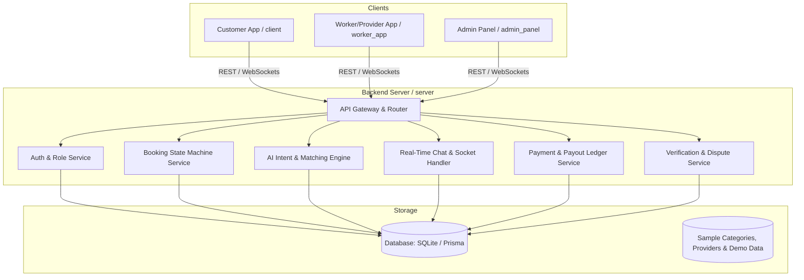

# Implementation Plan - Find Me: AI-Powered Hyperlocal Service Marketplace

Find Me is an intelligent AI-powered hyperlocal service marketplace (S-Commerce platform) connecting customers with verified local service providers through natural language intent understanding, real-time matching, transparent pricing, and end-to-end booking lifecycle management.

This plan details the end-to-end architecture and step-by-step roadmap to build the core MVP aligned with the specifications in [find-me-prd.md](file:///d:/College/My%20Works/UJPjkt/Find%20me/find-me-prd.md).

---

## User Review Required

> [!IMPORTANT]
> **Architecture & Technology Stack Decisions for the MVP**:
> 1. **Backend Server (`server/`)**: Node.js + Express + TypeScript with WebSocket support (Socket.IO) for real-time booking dispatch, live tracking updates, and in-app chat.
> 2. **Database (`database/`)**: SQLite with Prisma ORM / SQL schema for fast, lightweight local development, complete migrations, seed scripts, and seamless portability to PostgreSQL in production.
> 3. **AI Intent & Matching Engine (`server/src/ai/`)**:
>    - **Intent Classifier & Extractor**: Interprets conversational natural language prompts (e.g., *"AC not cooling, leaking water, need someone in Indiranagar today"*) into structured category, subcategory, urgency, time window, and estimated price ranges.
>    - **Clarification Dialogue Generator**: Generates follow-up clarifying questions when customer input is ambiguous.
>    - **Multi-Factor Ranking Algorithm**: Scores available providers based on distance (haversine/geo-proximity), skill match, rating, verified status, response time, and price fit.
> 4. **Customer Web & Mobile Client (`client/`)**: Modern responsive web application (HTML5/Vanilla CSS/Modern JS or Flutter) with dark/light premium aesthetic, AI conversational input + voice input simulation, category browser, live provider tracking simulation, in-app chat, checkout/payment simulation, and review flow.
> 5. **Worker/Provider App (`worker_app/`)**: Responsive provider portal for onboarding, service category configuration, online/offline availability toggle, real-time incoming lead modal with SLA countdown timer (60-120s), booking state management (`ACCEPTED` -> `EN_ROUTE` -> `IN_PROGRESS` -> `COMPLETED`), earnings ledger, and analytics.
> 6. **Admin Panel (`admin_panel/`)**: Comprehensive operator dashboard with provider verification queue, KYC approval/rejection, dispute resolution center, category/pricing taxonomy manager, and live marketplace KPIs (liquidity, conversion rate, cancellation rate).

> [!NOTE]
> All three apps (Customer, Worker, Admin) will be fully connected to the shared backend server and live database so you can test end-to-end interactions across customer booking, provider acceptance, live tracking, and admin moderation in real time.

---

## Proposed Architecture & Service Boundaries



---

## Data Models & State Machine

### Core Database Entities:
1. **User**: `id`, `name`, `email`, `phone`, `role` (`CUSTOMER` | `PROVIDER` | `ADMIN`), `avatarUrl`, `createdAt`
2. **ProviderProfile**: `id`, `userId`, `bio`, `experienceYears`, `idProofUrl`, `certificationUrl`, `verificationStatus` (`PENDING` | `VERIFIED` | `REJECTED`), `isAvailable`, `rating`, `reviewCount`, `latitude`, `longitude`, `serviceRadiusKm`, `hourlyRate`
3. **Category & Service**: `id`, `name`, `slug`, `icon`, `description`, `basePrice`, `priceUnit`, `urgencyMultiplier`
4. **ProviderService**: `id`, `providerId`, `categoryId`, `customPrice`
5. **Booking**: `id`, `customerId`, `providerId`, `categoryId`, `description`, `rawPrompt`, `urgency` (`LOW` | `MEDIUM` | `URGENT`), `status` (`REQUESTED` | `MATCHING` | `OFFERED` | `ACCEPTED` | `EN_ROUTE` | `IN_PROGRESS` | `COMPLETED` | `CANCELLED` | `DISPUTED`), `address`, `latitude`, `longitude`, `scheduledAt`, `estimatedPrice`, `finalPrice`, `slaExpiresAt`
6. **Message**: `id`, `bookingId`, `senderId`, `senderRole`, `content`, `createdAt`
7. **Payment**: `id`, `bookingId`, `amount`, `platformCommission`, `providerEarnings`, `status` (`HELD` | `RELEASED` | `REFUNDED`), `paymentMethod`
8. **Review**: `id`, `bookingId`, `customerId`, `providerId`, `rating`, `comment`, `createdAt`
9. **Dispute**: `id`, `bookingId`, `raisedById`, `reason`, `status` (`OPEN` | `UNDER_REVIEW` | `RESOLVED` | `REJECTED`), `resolutionNotes`

### Booking Lifecycle State Flow:
```
REQUESTED → MATCHING → OFFERED ────(accept)───→ ACCEPTED → EN_ROUTE → IN_PROGRESS → COMPLETED → REVIEWED
                          │ (decline/timeout)                                      │
                          ↓                                                        ↓
                     CANCELLED / RE-MATCH                                       DISPUTED → RESOLVED/REFUNDED
```

---

## Proposed Changes

### Phase 1: Database & Backend Server Setup (`server/` & `database/`)

#### [NEW] [package.json](file:///d:/College/My%20Works/UJPjkt/Find%20me/server/package.json)
- Setup dependencies: `express`, `cors`, `dotenv`, `socket.io`, `better-sqlite3` or `prisma`, `jsonwebtoken`, `bcryptjs`, `zod`, `typescript`, `ts-node-dev`.

#### [NEW] [server/src/index.ts](file:///d:/College/My%20Works/UJPjkt/Find%20me/server/src/index.ts)
- Main Express HTTP server & Socket.IO server initialization with CORS, JSON parsing, error handling middleware, and route mounting.

#### [NEW] [server/src/db/schema.sql](file:///d:/College/My%20Works/UJPjkt/Find%20me/server/src/db/schema.sql) & [server/src/db/database.ts](file:///d:/College/My%20Works/UJPjkt/Find%20me/server/src/db/database.ts)
- Database schema initialization, SQLite connection helper, transactions, and migration runner.

#### [NEW] [server/src/db/seed.ts](file:///d:/College/My%20Works/UJPjkt/Find%20me/server/src/db/seed.ts)
- Comprehensive realistic seed dataset:
  - 6 core service categories: AC Repair & Service, Plumbing & Water Supply, Electrical & Wiring, Home Deep Cleaning, Carpentry & Furniture, Appliance Repair.
  - 10+ verified and pending providers with realistic locations, photos, ratings, and price lists.
  - Demo customer, worker, and admin credentials for immediate testing.

#### [NEW] [server/src/ai/intentEngine.ts](file:///d:/College/My%20Works/UJPjkt/Find%20me/server/src/ai/intentEngine.ts)
- AI natural language intent parser: categorizes user free-text into category, intent keywords, urgency level, required tools/skills, and preliminary price estimate. Generates dynamic clarification questions for incomplete queries.

#### [NEW] [server/src/ai/matchingEngine.ts](file:///d:/College/My%20Works/UJPjkt/Find%20me/server/src/ai/matchingEngine.ts)
- Multi-factor ranking algorithm considering:
  - Distance (haversine formula based on customer & provider coordinates)
  - Category match & skill verification status
  - Availability status (`isAvailable == true`)
  - Rating & review count score
  - Historical response & completion rate
  - Price proximity to estimate

#### [NEW] [server/src/routes/](file:///d:/College/My%20Works/UJPjkt/Find%20me/server/src/routes)
- `authRoutes.ts`: Register, login, role check, token generation.
- `categoryRoutes.ts`: List service categories, subcategories, pricing guardrails.
- `aiRoutes.ts`: `/api/ai/parse-intent` and `/api/ai/clarify`.
- `bookingRoutes.ts`: Create booking, match providers, accept/decline offer, update status, cancel, get booking details & history.
- `providerRoutes.ts`: Profile update, availability toggle, earnings summary, reviews.
- `adminRoutes.ts`: Provider verification queue & approve/reject, disputes list & resolution, marketplace metrics.
- `reviewRoutes.ts`: Submit rating & review, anti-fraud checks.

#### [NEW] [server/src/sockets/socketHandler.ts](file:///d:/College/My%20Works/UJPjkt/Find%20me/server/src/sockets/socketHandler.ts)
- Real-time rooms for bookings, provider live location pings, SLA countdown timer synchronization, lead notifications, and chat messaging.

---

### Phase 2: Customer Web Application (`client/`)

Modern, responsive web app featuring high visual excellence, sleek dark/light theme, and dynamic interactions:

#### [NEW] [client/index.html](file:///d:/College/My%20Works/UJPjkt/Find%20me/client/index.html)
- Responsive app shell with navigation bar, hero conversational input, category grid, active booking tracker bar, provider directory, booking modal, live chat drawer, and review modal.

#### [NEW] [client/css/style.css](file:///d:/College/My%20Works/UJPjkt/Find%20me/client/css/style.css)
- Premium design system: curated color palette (deep slate, vibrant indigo/cyan accents, glassmorphic cards, smooth micro-animations, typography, dark mode optimization).

#### [NEW] [client/js/app.js](file:///d:/College/My%20Works/UJPjkt/Find%20me/client/js/app.js)
- Natural language intent assistant with typing animation & voice input simulation.
- Clarification questions prompt drawer when intent is ambiguous.
- Ranked provider matching view with ETA, distance badge, rating badges, transparent pricing breakdown.
- 1-Click instant booking & custom time slot picker.
- Live tracking screen with interactive status indicator (`ACCEPTED` -> `EN_ROUTE` -> `IN_PROGRESS` -> `COMPLETED`).
- Real-time in-app chat with assigned provider.
- In-app payment modal (Card, UPI, Wallets) and digital receipt generator.
- Post-service rating and feedback modal.

---

### Phase 3: Worker / Provider Portal (`worker_app/`)

Dedicated mobile-responsive dashboard for service professionals:

#### [NEW] [worker_app/index.html](file:///d:/College/My%20Works/UJPjkt/Find%20me/worker_app/index.html)
- Quick toggle for Online/Offline availability.
- Incoming Lead Alert modal with 90-second SLA countdown timer and customer requirement summary.
- Active Job Management Console: step-by-step status progress buttons (*Start Route*, *Arrived & Start Job*, *Complete Job*).
- In-app chat drawer to communicate with customer.
- Earnings & Ledger view: today's earnings, completed jobs, commission breakdown, and payout request button.
- Profile & Category manager: toggle offered services, base rates, service radius.

#### [NEW] [worker_app/css/worker.css](file:///d:/College/My%20Works/UJPjkt/Find%20me/worker_app/css/worker.css) & [worker_app/js/worker.js](file:///d:/College/My%20Works/UJPjkt/Find%20me/worker_app/js/worker.js)
- Real-time Socket.IO listener for instant booking dispatch and sound/visual alerts.
- Live status update dispatching.

---

### Phase 4: Admin & Operations Console (`admin_panel/`)

Operator command center for marketplace health and trust & safety:

#### [NEW] [admin_panel/index.html](file:///d:/College/My%20Works/UJPjkt/Find%20me/admin_panel/index.html)
- Real-time KPI metrics: Total GMV, Active Requests, Liquidity % (fulfilled vs unfulfilled), Avg Match Time, Provider Utilization.
- Provider Verification Queue: View submitted ID docs, skills, experience, and 1-click Approve / Reject.
- Dispute & Incident Center: View customer/provider disputes, inspect chat logs, and issue refunds or payout releases.
- Category & Pricing Manager: Adjust base prices, emergency surge multipliers, and add new categories.
- User & Provider Management table with account status toggling.

#### [NEW] [admin_panel/css/admin.css](file:///d:/College/My%20Works/UJPjkt/Find%20me/admin_panel/css/admin.css) & [admin_panel/js/admin.js](file:///d:/College/My%20Works/UJPjkt/Find%20me/admin_panel/js/admin.js)
- Clean, data-dense, dark-themed dashboard with responsive tables, live stat counters, modal viewers, and search/filtering.

---

### Phase 5: Documentation & Unified Launcher

#### [MODIFY] [README.md](file:///d:/College/My%20Works/UJPjkt/Find%20me/README.md)
- Complete setup, architectural overview, API documentation, demo user accounts, and instructions to run all 3 apps simultaneously.

---

## Verification Plan

### Automated & API Tests
1. **Server & Database API Verification**:
   - Seed script test: `npm run seed` executes and inserts categories, providers, users, and demo bookings.
   - Endpoint test for AI intent classification (`POST /api/ai/parse-intent`) with various natural language prompts.
   - Endpoint test for provider matching (`POST /api/bookings/match`) validating multi-factor ranking.
   - Lifecycle state machine test: moving a booking from `REQUESTED` -> `ACCEPTED` -> `EN_ROUTE` -> `IN_PROGRESS` -> `COMPLETED`.

### Manual End-to-End Simulation
1. **Customer Intent & Matching Flow**:
   - Open Customer App (`http://localhost:3000` or via client server).
   - Enter natural language prompt: *"My kitchen pipe is leaking heavily under the sink, need emergency repair"*.
   - Verify AI classifies category as "Plumbing & Water Supply", sets urgency to "URGENT", and suggests price.
   - Review ranked list of verified plumbers with distance and ETA.
2. **Provider Dispatch & Acceptance Flow**:
   - Open Worker App in a second browser window (`http://localhost:3001` or worker portal).
   - Verify incoming booking alert pops up with audio/visual pulse and SLA countdown.
   - Click "Accept Booking" within the SLA window.
3. **Live Tracking & Status Updates**:
   - Provider advances status to "En Route" -> Customer sees live status update and estimated arrival.
   - Provider advances status to "In Progress" -> "Completed".
4. **Payment & Review**:
   - Customer completes checkout payment simulation and submits a 5-star rating with review.
   - Verify review reflects on provider profile and updates provider rating.
5. **Admin Operations**:
   - Open Admin Panel (`http://localhost:3002` or admin portal).
   - Verify live KPI counters update (GMV, Bookings, Liquidity).
   - Review pending provider verification in the queue and test "Approve".
